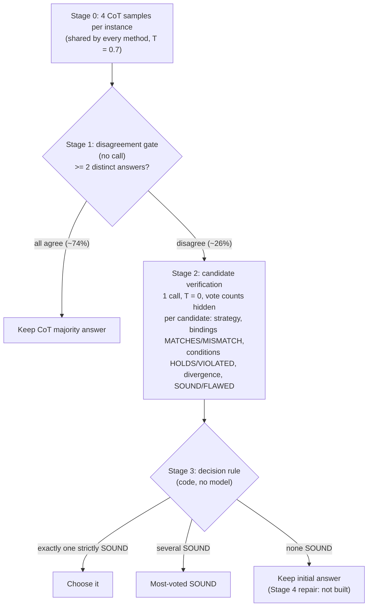

<div align="center">

# Explicit Strategy Verification (ESV)

### Robust mathematical & coding reasoning through error identification, diagnosis and recovery under structural perturbations

*(RAEN — `RAEN_structural-perturbations-esv`)*


</div>

---

## Target venues

| Venue | Track | Intended contribution | Status |
|---|---|---|---|
| **ICML 2027** | Main conference | Full paper: ESV protocol, the verifier-independence finding, and the quantitative likelihood-ratio criterion for when verification can beat majority voting | Planned. Two controls still pending (see [Open work](#open-work)) |
| **AAAI workshops** | Reasoning / LLM-reliability style workshops | Analysis-paper fallback: the negative self-verification result across two benchmarks, plus the independent-verifier result | Planned |

> **Note for reviewers.** Nothing here has been submitted yet. Venue names are the authors' *targets*, not acceptances. Deadlines, page limits and anonymity rules must be taken from each venue's official call for papers; they are deliberately not restated here. The go / no-go rule that decides between the two framings was fixed **before** the held-out run (see [Pre-registration](#pre-registration-and-split-discipline)).

---

## Contents

1. [TL;DR](#tldr)
2. [Research questions](#research-questions)
3. [Headline results](#headline-results)
4. [The ESV method](#the-esv-method)
5. [The benchmark: structural perturbations](#the-benchmark-structural-perturbations)
6. [Pre-registration and split discipline](#pre-registration-and-split-discipline)
7. [Repository map](#repository-map)
8. [Reviewer's guide: suggested reading order](#reviewers-guide-suggested-reading-order)
9. [Reproducing the results](#reproducing-the-results)
10. [Data and results layout](#data-and-results-layout)
11. [Research timeline (how we got here)](#research-timeline-how-we-got-here)
12. [Limitations](#limitations)
13. [Open work](#open-work)
14. [Configuration, cost and security notes](#configuration-cost-and-security-notes)
15. [Citation, license, contact](#citation-license-contact)

---

## TL;DR

When a problem is changed so that the familiar solution strategy **no longer applies**, language models tend to apply it anyway. This project asks whether a model can notice that from the **problem text alone** (no answer key) and whether doing so beats simply trusting the majority vote.

**Explicit Strategy Verification (ESV)** takes the solver's own competing candidate solutions and, in one call, checks each one: *does the strategy bind correctly to the quoted givens, and do the method's conditions hold?* Code then turns that checklist into a SOUND / not-SOUND decision per candidate.

**Main finding.** On GSM8K with three small open-weight solvers, **who does the checking decides everything**:

| Checker | Accuracy (pooled, 1170 instances) | Fixes / breaks vs CoT maj@4 |
|---|---|---|
| Solver checks itself | 85.1% (below baseline) | 18 / 57 |
| **Independent checker (`gpt-oss-120b`)** | **93.5%** (baseline 88.5%) | **61 / 2** |

The ESV *structure* is identical in both rows; only the checker changes. Self-verification is near chance (likelihood ratio 1.6); an independent checker separates right from wrong candidates cleanly (likelihood ratio 47.5).

---

## Research questions

| # | Question |
|---|---|
| **RQ1** | Can a verifier detect an invalid strategy from the problem's own givens? |
| **RQ2** | Does that signal beat the free majority vote it has to overturn? |
| **RQ3** | Does it matter who verifies: the solver itself, or an independent model? |
| **RQ4** | Does ESV beat Direct QA, CoT maj@4 and Universal Self-Consistency (USC)? |

Every method starts from the **same four CoT samples**. None re-solves the problem; they differ only in *which evidence they use to pick among answers the solver already produced*. Gold answers are used only for scoring, so a method can damage the baseline as easily as improve it, and is scored that way (paired fixes / breaks, exact McNemar).

| Method | Extra calls | Evidence used to choose |
|---|---|---|
| Direct QA maj@4 | 0 | none (no reasoning) |
| CoT maj@4 (baseline) | 0 | the vote |
| Universal Self-Consistency (control) | 1 | the vote, read in prose |
| **ESV (ours)** | 1 | the problem's givens; vote counts are *hidden* from the checker |

---

## Headline results

All numbers: 198 frozen GSM8K (original, perturbed) pairs, 3 solvers (Qwen 2.5 7B, Mistral Nemo 12B, Gemma 3 4B), 4 samples each at T = 0.7, 6 disputed-gold instances excluded. Exact McNemar tests against CoT maj@4 on the same instances. The decision rule and checker were frozen on the **dev** split; **held-out** pairs were never used for tuning.

| Method | dev (357) | **held-out (813)** | all (1170) | all: fixes / breaks | all: p |
|---|---|---|---|---|---|
| Direct QA maj@4 | 13.7% | 11.4% | 12.1% | 7 / 900 | ≈ 0 |
| CoT pass@1 | 85.0% | 85.2% | 85.1% | – | – |
| **CoT maj@4 (baseline)** | 87.7% | 88.8% | 88.5% | – | – |
| Universal Self-Consistency | 88.5% | 89.7% | 89.3% | 15 / 5 | 0.041 |
| ESV, self-check | 85.2% | 85.1% | 85.1% | 18 / 57 | 7.2e-06 |
| **ESV, independent check** | **92.2%** | **94.1%** | **93.5%** | **61 / 2** | **4.4e-16** |
| CoT pass@4 (oracle ceiling) | 93.3% | 95.1% | 94.5% | – | – |

**Pre-registered go / no-go: GO.** ESV beats CoT maj@4 by ≥ 3 pp (observed +5.0 pp, all splits; +5.3 pp held-out) **and** beats USC (+4.2 pp, p = 1.5e-12). The self-check failure replicates on held-out data (42 breaks).

### Why independence matters (the central diagnostic)

| Per-candidate detector (all 198 pairs) | Self-check | Independent |
|---|---|---|
| Right candidates called SOUND | 57.0% | 86.7% |
| Wrong candidates called SOUND | 36.5% | 1.8% |
| Precision of a SOUND verdict | 44.8% | 96.1% |
| **Likelihood ratio** | **1.6** | **47.5** |

A candidate with 1 / 2 / 3 votes is correct roughly 10–12% / 50% / 78–81% of the time, so a verdict must carry a likelihood ratio of about **> 3.4–4.2** (2-vote over 3-vote), **> 7–10** (1-vote over 2-vote) or **> 30** (1-vote over 3-vote) to overturn the vote. Self-checking (LR 1.6) only wins on tied votes; the independent checker clears every tier. This yields a cheap pre-test: *measure a checker's likelihood ratio on ~50 instances before a full run.*

Self-verification fails not for lack of looking: the checker's text engages the changed condition in 83% of breaking-P′ calls. It quotes the perturbed given, then ratifies the solution that misused it. Judging whether a solution uses a quoted given correctly is as hard as solving the problem, and the same model errs in the same direction.

### Breakdown (all 198 pairs, CoT maj@4 → ESV independent)

| By solver | Qwen 2.5 7B | Mistral Nemo 12B | Gemma 3 4B |
|---|---|---|---|
| Accuracy | 91.0 → 94.6 (14 / 0) | 84.4 → 92.8 (35 / 2) | 90.0 → 93.1 (12 / 0) |

| By arm | Original | Breaking P′ | Preserving P′ |
|---|---|---|---|
| Accuracy | 90.6 → 94.4 (23 / 1) | 79.1 → 87.5 (25 / 0) | 93.6 → 97.6 (13 / 1) |

Selection quality on the 303 disagreeing instances: majority vote 61.1%, USC 64.4%, **ESV independent 80.5%**, oracle 84.5%, i.e. ESV recovers most of the gap between voting and the oracle.

> The authoritative, regenerable write-ups are
> [`esv3_bottleneck_gsm8k.md`](experiments/results/gsm8k/analysis/esv3_bottleneck_gsm8k.md) (narrative, start here) and
> [`esv3_report_small.gpt-oss-120b.md`](experiments/results/gsm8k/analysis/esv3_report_small.gpt-oss-120b.md) (full stage-by-stage tables).
> Large solvers (Qwen 72B, Mistral Small 24B, Llama 3.3 70B) already reach ~97% CoT maj@4 on GSM8K (≈ 2 pp headroom), so they are reported as a *no-headroom control*, not a test.

---

## The ESV method

ESV v3 starts from the 4 CoT samples already stored in `records.json` and never re-solves.



1. **Disagreement gate** (free). Group the 4 answers into distinct candidates. If they all agree, keep the majority answer and stop. Only disagreeing instances can change, so the checker runs on about a quarter of instances.
2. **Candidate verification** (one call, T = 0). For every distinct candidate, in order of first appearance and *without vote counts*: the strategy, its bindings to quoted givens (MATCHES / MISMATCH), the method's conditions (HOLDS / VIOLATED), the divergence point, then SOUND or FLAWED with a failure type (BINDING / METHOD / COMPUTATION), the first flawed step and the corrected fact.
3. **Choice** (code). A candidate counts as *strictly SOUND* only if its verdict is SOUND **and** it lists no MISMATCH and no VIOLATED. One SOUND → choose it; several → most votes; none → keep the initial answer.
4. **Diagnosis-driven repair** is **not built**. `none_sound` keeps the initial answer, so ESV never invents an answer the solver did not already produce. Its ceiling is reported in the analysis.

**Fairness safeguards.** Gold enters only at scoring. The checker never sees gold or vote counts. The **control** is Universal Self-Consistency (Chen et al., 2023) on the same samples and the same gate; it *can* see multiplicity.

---

## The benchmark: structural perturbations

Each benchmark item is a frozen pair **(P, P′)**: an original problem and a perturbed variant that changes one structure, relationship or constraint while staying well-defined, solvable and superficially similar. Two modes, balanced ≈ 50 / 50:

| Mode | Definition |
|---|---|
| **Strategy-breaking** | Applying the original strategy *S* unchanged to P′ gives a wrong answer or cannot be completed. The wrong answer is the *trap*. |
| **Strategy-preserving** | P′ is a genuinely new instance (the answer changes and must be recomputed) but *S* still works. Controls for "any change hurts". |

*Example (GSM8K pair 131).* Original: Sofie walks twice as far as Brian over 7 days (answer 35). Perturbed: Sofie walks twice as far as Brian walks in **one** day (answer 245). The comparison changes, so the original strategy's answer is the trap.

**Construction** (`build_dataset.py`, prompts in `perturb_prompts.py`): a generator model (DeepSeek V4 Flash) names the strategy *S*, changes one condition and states the new answer; two independent verifier models (`qwen3.5-35b-a3b`, `gpt-oss-120b`) then (1) solve P′ blind, seeing neither P nor *S*, to avoid anchoring, and (2) mechanically apply *S* to P′. A pair is accepted only if the intended mode is confirmed. P′ keeps the original's answer format.

| Benchmark | Source | Sampled → pairs | Split (breaking / preserving) | Status |
|---|---|---|---|---|
| **GSM8K** | `openai/gsm8k` main, test | 1317 → 200 → **198** | 99 / 99 | **Primary; complete; GO** |
| JEEBench (math) | JEE Advanced 2016–2023 | 236 → 200 → **193** | 97 / 96 | Retired dev benchmark |

Both datasets use sample seed 2026. Frozen files: [`gsm8k`](experiments/data/gsm8k/frozen_dataset.json), [`jeebench`](experiments/data/jeebench/frozen_dataset.json). Every generation attempt is logged in `generation_log.jsonl`.

---

## Pre-registration and split discipline

- **Go / no-go (fixed in advance):** ESV must beat CoT maj@4 by **≥ +3 pp** *and* beat USC. Otherwise the project becomes an analysis paper.
- **Dev split:** pairs 0–59 (357 instances). The decision rule and the independent verifier were fixed here.
- **Held-out split:** pairs 60–197 (813 instances), never used for tuning. Reports record the split in the file name (`.upto60`, `.from60`).
- **Disputed labels:** 6 GSM8K originals whose published gold is wrong or ambiguous are excluded from every score (`common.DISPUTED_INSTANCES`: `105`, `111`, `189`, `40`, `82`, `95`).
- **Chronology matters.** The dev-set *self-check* run was a NO-GO (ESV 85.2% vs USC 88.5%); the bottleneck analysis diagnosed the verifier as the weak link and proposed the independent verifier, which was then confirmed on untouched held-out pairs. The full narrative is in [`esv3_bottleneck_gsm8k.md`](experiments/results/gsm8k/analysis/esv3_bottleneck_gsm8k.md).

---

## Repository map

```text
RAEN_structural-perturbations-esv/
├── README.md                        <- you are here
├── LICENSE                          Apache-2.0
├── experiments/                     CURRENT code, data and results (start here)
│   ├── README.md                    detailed run-order and file roles for the experiment code
│   ├── common.py                    config (models, seeds, n=4, T), OpenRouter client, tagged-output calls, scoring, McNemar
│   ├── benchmarks.py                loads / caches source problems per benchmark (GSM8K, JEEBench)
│   ├── perturb_prompts.py           generator + verifier prompts for both perturbation modes
│   ├── build_dataset.py             sample 200 -> two-stage perturbation -> data/<benchmark>/frozen_dataset.json
│   ├── method_prompts.py            Direct QA, CoT, ESV v3 and USC prompts
│   ├── run_methods.py               the 4 Direct QA + 4 CoT samples every method starts from
│   ├── run_esv3.py                  ESV v3 + USC control (--verifier-model = independent checker)
│   ├── analyze_esv3.py              offline reports: stage tables, go / no-go, every comparison
│   ├── tests/smoke_test_offline.py  end-to-end check on both benchmarks with a fake client, no API calls
│   ├── data/{gsm8k,jeebench}/       source, sampled, frozen datasets, generation logs
│   └── results/{gsm8k,jeebench}/    per-solver records and analysis reports
├── pilot_experiment/src/            ARCHIVED pilot (Oct 2026): original 5-stage ESV, JEEBench, one solver
│   ├── main.py                      pilot dataset builder / runner
│   ├── methods/esv.py               pilot 5-stage ESV pipeline (recognition → diagnosis → strategy → recovery → final)
│   ├── methods/DQV_CoT_Code_strict.py   Direct QA / CoT baselines
│   ├── prompts/, helpers/           prompt builders and formatting
│   └── results/                     pilot reports, metrics, per-instance CSV
└── presentation/                    ESV_Project_Proposal{,_v2,_v3}.{pptx,pdf}  (v3 = current, 14 slides)
```

### What each experiment file does

| File | Role |
|---|---|
| [`common.py`](experiments/common.py) | Single source of truth: `SMALL_SOLVER_MODELS`, `SOLVER_MODELS`, `NUM_SAMPLES = 4`, `SAMPLE_TEMPERATURE = 0.7`, `SAMPLE_SEED = 2026`, type-aware answer scoring, exact McNemar, resumable I/O |
| [`benchmarks.py`](experiments/benchmarks.py) | Normalizes each benchmark's problems to one shape; pulls and caches GSM8K |
| [`perturb_prompts.py`](experiments/perturb_prompts.py) | Format-preserving prompts for breaking and preserving perturbations |
| [`build_dataset.py`](experiments/build_dataset.py) | Samples 200, perturbs, verifies, balances modes, freezes the dataset (`--freeze-only` rebuilds from the log) |
| [`method_prompts.py`](experiments/method_prompts.py) | Prompts for Direct QA, CoT, ESV v3 verification and USC |
| [`run_methods.py`](experiments/run_methods.py) | Produces `records.json` (4 DQA + 4 CoT samples per instance) |
| [`run_esv3.py`](experiments/run_esv3.py) | Runs ESV v3 and USC; resumes where it stopped |
| [`analyze_esv3.py`](experiments/analyze_esv3.py) | Rebuilds every report from stored records, offline; `--min-pair` / `--max-pair` select the split |
| [`tests/smoke_test_offline.py`](experiments/tests/smoke_test_offline.py) | Exercises every step, rejection path, both modes, independent-verifier mode, USC, resume and the expired-key stop |

---

## Reviewer's guide: suggested reading order

| Time | Read | You get |
|---|---|---|
| 5 min | This README, [`presentation/ESV_Project_Proposal_v3.pdf`](presentation/ESV_Project_Proposal_v3.pdf) | Problem, method, headline numbers, worked example (pair 131) |
| 15 min | [`esv3_bottleneck_gsm8k.md`](experiments/results/gsm8k/analysis/esv3_bottleneck_gsm8k.md) | The full diagnosis, dev → held-out chronology, likelihood-ratio arithmetic |
| 20 min | [`esv3_report_small.gpt-oss-120b.md`](experiments/results/gsm8k/analysis/esv3_report_small.gpt-oss-120b.md) | Stage-by-stage tables, USC resolution rates, per-candidate detector, per-arm results |
| 15 min | [`experiments/method_prompts.py`](experiments/method_prompts.py), [`run_esv3.py`](experiments/run_esv3.py) | The exact verification prompt and decision rule |
| 10 min | [`experiments/common.py`](experiments/common.py) | Scoring, normalization, McNemar, disputed-instance handling |
| 10 min | [`esv_bottleneck_analysis.md`](experiments/results/jeebench/analysis/esv_bottleneck_analysis.md) | Why the earlier JEEBench design was retired |
| optional | `experiments/results/gsm8k/<model>/*.json` | Raw per-instance records behind every table |

### Claim → evidence map

| Claim | Where to verify |
|---|---|
| Self-check ≈ chance (LR 1.6); independent checker LR ≈ 47 | Per-candidate detector table in `esv3_report_small.gpt-oss-120b.md`; `esv3_bottleneck_gsm8k.md` |
| ESV-independent beats CoT maj@4 and USC on held-out data | `esv3_report_small.gpt-oss-120b.from60.md`; "Held-out confirmation" in `esv3_bottleneck_gsm8k.md` |
| Self-check fails on the dev split (NO-GO) | `esv3_report_small.upto60.md` |
| USC actually selected (not silently falling back to the majority) | "Did USC actually select?" table in the full report |
| Failures concentrate on strategy-breaking P′ | "What the wrong answers are" table (79.1% maj@4 on breaking vs 90.6% on originals) |
| Scoring and gold labels are not the cause of earlier JEEBench failures | Section 5 of `esv_bottleneck_analysis.md` |

### Report index (`experiments/results/gsm8k/analysis/`)

| File | Contents |
|---|---|
| `esv3_bottleneck_gsm8k.md` | **Authoritative narrative**: dev NO-GO → diagnosis → independent verifier → held-out GO → final table |
| `esv3_report_small.gpt-oss-120b.md` | Full report, independent checker, all 198 pairs |
| `…gpt-oss-120b.upto60.md` / `.from60.md` | Same, dev split / held-out split |
| `esv3_report_small.md` (+ `.upto60`, `.from60`) | Self-check condition (also the source of the USC arm) |
| `esv3_report.md` | Large-solver arm (no-headroom control) |

---

## Reproducing the results

**Requirements.** Python 3.12 (used throughout), plus `openai`, `python-dotenv`, `tqdm`; `datasets` is needed only to pull GSM8K from Hugging Face (a cached copy is committed at `experiments/data/gsm8k/source.json`). There is no pinned requirements file yet.

```bash
pip install openai python-dotenv tqdm datasets
```

### 1. Offline checks (no API key, no cost)

```bash
# Every pipeline step on both benchmarks against a fake model client; writes only to a temp folder
python experiments/tests/smoke_test_offline.py

# Rebuild any committed report from stored records (no API calls)
python experiments/analyze_esv3.py --benchmark gsm8k --models small --verifier-model openai/gpt-oss-120b
python experiments/analyze_esv3.py --benchmark gsm8k --models small --verifier-model openai/gpt-oss-120b --min-pair 60   # held-out
python experiments/analyze_esv3.py --benchmark gsm8k --models small --verifier-model openai/gpt-oss-120b --max-pair 60   # dev
```

### 2. Full live run (needs an OpenRouter key)

Create `experiments/.env` containing `OPENROUTER_API_KEY=...` (git-ignored) or point `RAEN_ENV_FILE` at one. Every step resumes where it stopped.

```bash
B=gsm8k
python experiments/benchmarks.py $B                                             # 1. pull / summarize source
python experiments/build_dataset.py --benchmark $B --limit 10                   # 2. small live check of the perturbation pipeline
python experiments/build_dataset.py --benchmark $B                              #    then all 200 problems
python experiments/run_methods.py --benchmark $B \
    --models qwen/qwen-2.5-7b-instruct mistralai/mistral-nemo google/gemma-3-4b-it   # 3. the 4 DQA + 4 CoT samples
python experiments/analyze_esv3.py --benchmark $B --models small               #    stage 1: headroom + trap rate
python experiments/run_esv3.py --benchmark $B \
    --models qwen/qwen-2.5-7b-instruct mistralai/mistral-nemo google/gemma-3-4b-it   # 4a. self-check + USC control
python experiments/run_esv3.py --benchmark $B --verifier-model openai/gpt-oss-120b \
    --models qwen/qwen-2.5-7b-instruct mistralai/mistral-nemo google/gemma-3-4b-it   # 4b. independent check
python experiments/analyze_esv3.py --benchmark $B --models small --verifier-model openai/gpt-oss-120b
```

Decide on stage 1 before paying for the checker: if the solvers' four CoT samples almost never disagree, or almost no disagreement is fixable, there is no headroom.

> **Reproducibility caveats.** Model outputs come from hosted OpenRouter providers and may drift; sampling is T = 0.7 with seeds 0–3. The frozen datasets and every stored raw response are committed, so **all tables regenerate exactly and offline from the stored records**. Re-running live calls will approximate, not bit-reproduce, them.

---

## Data and results layout

```text
experiments/data/<benchmark>/
    source.json              GSM8K only: cached source problems
    sample_200.json          the seeded 200-problem sample
    generation_log.jsonl     every perturbation attempt (accepted and rejected)
    frozen_dataset.json      final (P, P') pairs with gold, strategy, changed condition, validation
experiments/results/<benchmark>/<solver>/
    records.json                          4 Direct QA + 4 CoT samples per instance
    esv3_records.json                     ESV v3 with self-check (+ USC arm)
    esv3_records.<verifier>.json          ESV v3 with the independent checker
experiments/results/<benchmark>/analysis/ reports, and for JEEBench also figures, CSV and metrics.json
```

**Size note.** The JEEBench `records.json` files for the small solvers are 28–33 MB each, and `experiments/results/` holds roughly 140 MB of raw records and reports in total. They are kept deliberately so every figure is auditable.

**Legacy keys.** JEEBench records still hold `esv` / `retry` / `extra` blocks from retired experiments; no current script reads them, and `run_methods.py --no-resume` would discard them.

---

## Research timeline (how we got here)

| Phase | Setup | Outcome | Evidence |
|---|---|---|---|
| **Pilot** (Oct 2026) | 5-stage ESV (recognition → diagnosis → alternative strategy → recovery → final), Qwen 2.5 7B, 16 JEEBench pairs (32 instances) | 40.6% → 56.2% after ESV; diagnosis only 15.8%. Too small to trust; motivated a larger, controlled study | [`pilot_experiment/src/results/esv_report_qwen-2.5-7b-instruct.md`](pilot_experiment/src/results/esv_report_qwen-2.5-7b-instruct.md) |
| **JEEBench experiments** | ESV v4 (oracle trigger), ESV v2 + controls, gold-free ESV v2; 6 solvers | **Negative.** Stages did not beat compute-matched retry; recognition near chance; selection was the bottleneck; only 5–10% of wrong answers were the trap and half of failures were on untouched originals. Benchmark retired | [`esv_bottleneck_analysis.md`](experiments/results/jeebench/analysis/esv_bottleneck_analysis.md), [`method_comparison.md`](experiments/results/jeebench/analysis/method_comparison.md), [`v4_failure_analysis.md`](experiments/results/jeebench/analysis/v4_failure_analysis.md) |
| **GSM8K, ESV v3, self-check** | Simplified to disagreement gate + candidate verification + code decision rule | **NO-GO on dev** (85.2% vs USC 88.5%); verdict LR 1.6 | [`esv3_report_small.upto60.md`](experiments/results/gsm8k/analysis/esv3_report_small.upto60.md) |
| **GSM8K, ESV v3, independent check** | Same protocol, `gpt-oss-120b` as checker | **GO** on dev and on held-out; LR ≈ 47 | [`esv3_bottleneck_gsm8k.md`](experiments/results/gsm8k/analysis/esv3_bottleneck_gsm8k.md) |

Retired runners (ESV v2 / v4, the retry controls, `analyze.py`) were removed from the working tree; recover them from git history if needed. Their reports and raw records remain.

---

## Limitations

- **Scope.** One primary benchmark (GSM8K), three small open-weight solvers, integer answers only.
- **Checker strength is confounded with independence.** The checker (`gpt-oss-120b`) is larger than the solvers. Two controls (below) separate "the ESV structure helps" from "a bigger model picks better".
- **Headroom.** Large solvers are near ceiling on GSM8K (~97% maj@4), so they cannot test a selection method.
- **Selection only.** ESV chooses among existing candidates; its ceiling is CoT pass@4 (94.5%). It cannot create a new answer (stage 4 not built).
- **Generalization.** ESV needs givens that can be quoted from the problem text; expected to hold for word problems, MATH-style perturbations and code I/O contracts, and to weaken where difficulty lies in unstated domain knowledge.
- **Label noise.** Six GSM8K originals were excluded by hand-checking; perturbed siblings keep their generator-verified gold.
- **LLM-generated benchmark.** Perturbations are produced and verified by models. Acceptance rates are 100% / 98% (breaking / preserving), so rejection filtering is light.
- **Cost.** One checker call per disagreeing instance (~26% of instances); about 524 extra tokens per instance on average.

## Open work

| Item | Purpose | Status |
|---|---|---|
| **Judge-select control** | Same verifier and candidates, asked only "which answer is correct" with no bindings protocol. Tests whether the ESV *structure* matters | Pending |
| **Same-size cross-verifier** | e.g. Nemo checks Qwen and vice versa. Separates independence from capability | Pending |
| Large-solver arm | Report as a no-headroom control | Optional |
| Harder / second benchmark | MATH-Perturb, code I/O contracts | Future |
| Stage 4 repair | Use the diagnosis when no candidate survives | Future (ceiling is quantified in the report's decisions table) |
| Pinned `requirements.txt` | Environment reproducibility | To do |

---

## Configuration, cost and security notes

- Models are accessed through [OpenRouter](https://openrouter.ai). **Never commit API keys.** `.env` / `env` are git-ignored; keys are read from `experiments/.env`, an `env` file in a parent folder, or `RAEN_ENV_FILE`.
- Generator: `deepseek/deepseek-v4-flash-0731`. Dataset verifiers: `qwen/qwen3.5-35b-a3b`, `openai/gpt-oss-120b`. Judge (pilot only): `openai/gpt-oss-120b`.
- Solvers (small, primary): `qwen/qwen-2.5-7b-instruct`, `mistralai/mistral-nemo`, `google/gemma-3-4b-it`. Solvers (large, control): `qwen/qwen-2.5-72b-instruct`, `mistralai/mistral-small-3.2-24b-instruct`, `meta-llama/llama-3.3-70b-instruct`.
- Environment overrides: `ESV_DATA_DIR`, `ESV_RESULTS_DIR`, `ESV_BENCHMARK`, `JEE_MAX_RETRIES`, `JEE_RATE_LIMIT_RETRIES`, `JEE_TIMEOUT_SECONDS`.
- Reference cost: the independent-verifier test on 89 dev disagreements cost about USD 0.30.
- The archived pilot scripts (`pilot_experiment/src/`) predate the shared `common.py` and were never refactored to it. Treat the pilot as historical.

---

## Citation, license, contact

**Citation.** A paper is in preparation. Until a preprint is available, please cite the repository:

```bibtex
@misc{raen_esv_2026,
  title        = {Explicit Strategy Verification: Recognizing and Repairing Invalid Reasoning
                  Strategies under Structural Perturbations},
  author       = {{StellarDrift15}},
  year         = {2026},
  howpublished = {\url{https://github.com/StellarDrift15/RAEN_structural-perturbations-esv}},
  note         = {Research code and data; manuscript in preparation}
}
```

**Key references.** JEEBench (Arora et al., 2023, [arXiv:2305.15074](https://arxiv.org/abs/2305.15074)); *Large Language Models Cannot Self-Correct Reasoning Yet* (Huang et al., 2024, [arXiv:2310.01798](https://arxiv.org/abs/2310.01798)); Universal Self-Consistency (Chen et al., 2023); GSM8K (Cobbe et al., 2021).

**License.** [Apache License 2.0](LICENSE).

**Contact.** Open an issue on this repository.
