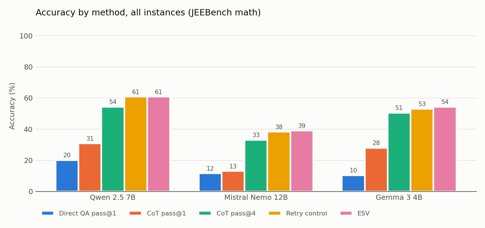
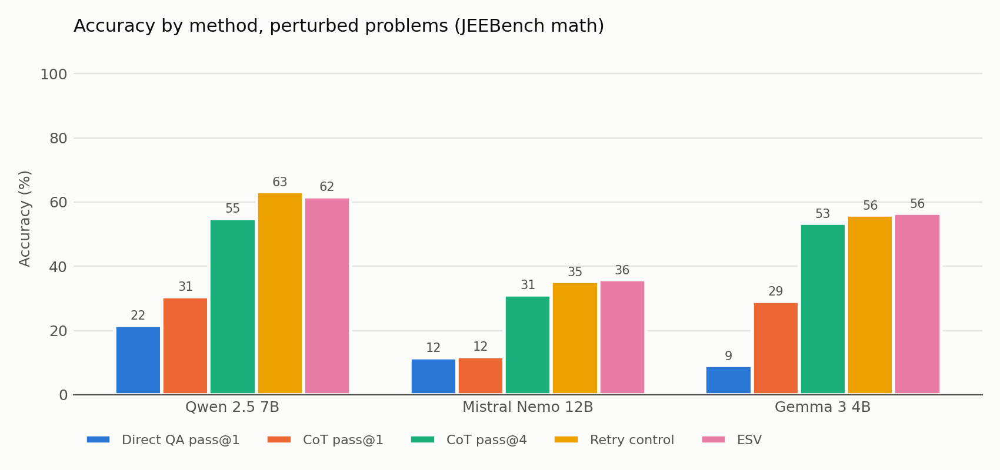
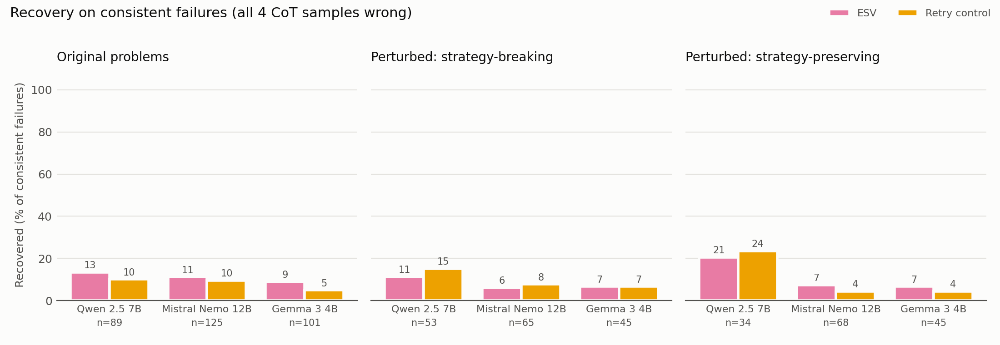
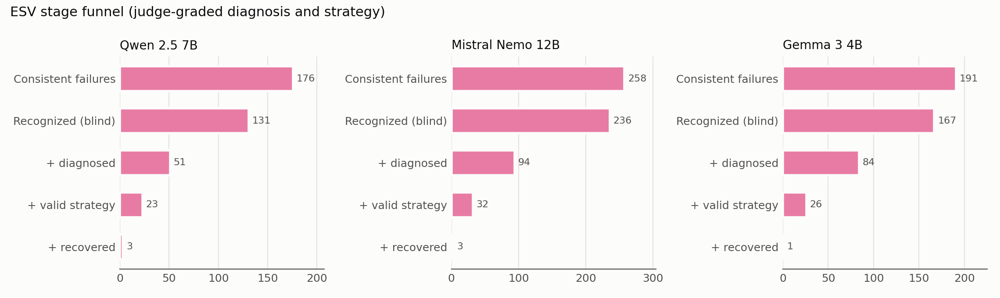

# JEEBench (math): Direct QA vs CoT vs ESV across three solver models

Generated 2026-11-02T21:45:23.594765+00:00 by `jeebench_experiment/analyze.py`.

## Dataset

- 200 math problems sampled at random from JEEBench (seed 2026); 200 processed; **193 frozen (P, P') pairs**.
- Perturbation split: **97 strategy-breaking / 96 strategy-preserving**; problems attempted per mode {'breaking': 102, 'preserving': 98}, acceptance rate {'breaking': 0.951, 'preserving': 0.9796}.
- Generator deepseek/deepseek-v4-flash-0731; verifiers qwen/qwen3.5-35b-a3b, openai/gpt-oss-120b. P' keeps the original answer format (single-correct MCQ, multiple-correct MCQ, integer, numeric).
- Question-type composition per arm: {'breaking': {'MCQ(multiple)': 32, 'MCQ': 21, 'Numeric': 30, 'Integer': 14}, 'preserving': {'MCQ(multiple)': 36, 'Numeric': 25, 'MCQ': 20, 'Integer': 15}}

## Scoring

Every method gets 4 samples per instance at temperature 0.7. **pass@1** = mean correctness of the samples; **maj@4** = majority answer; **pass@4** = any sample correct. ESV runs only on *consistent failures* (all 4 CoT samples wrong). The headline reports what ESV does on those instances, and a realistic accuracy that uses the CoT majority vote wherever ESV did not run. Under the any-correct (oracle) gate, ESV is scored as correct if any CoT sample is correct or the ESV final answer is correct, so **ESV - CoT pass@4 is exactly the share of instances that resampling never solved but ESV did.** The retry control uses the same trigger and the same "your answer is wrong" information without the ESV stages, so **ESV - Retry isolates the ESV stages themselves.** 95% CIs: bootstrap over pairs.

## Coverage

| Model | Instances scored | Incomplete (excluded) |
|---|---|---|
| Qwen 2.5 7B | 386 / 386 | 0 |
| Mistral Nemo 12B | 386 / 386 | 0 |
| Gemma 3 4B | 386 / 386 | 0 |

## Headline 1: recovery on consistent failures (all 4 CoT samples wrong)

Of the instances the model failed 4 out of 4 times, the share whose final answer is correct. Chance = expected recoveries from guessing uniformly among the answers left after the known-wrong one is excluded.

| Group | Metric | Qwen 2.5 7B | Mistral Nemo 12B | Gemma 3 4B |
|---|---|---|---|---|
| all | ESV recovered | 14.2% (25/176) | 8.9% (23/258) | 7.8% (15/191) |
| all | Retry control recovered | 14.2% (25/176) | 7.8% (20/258) | 5.2% (10/191) |
| all | Expected by chance | 14.76 | 18.87 | 17.26 |
| all | p (ESV vs chance) / p (ESV vs Retry) | 0.003 / 1.000 | 0.173 / 0.749 | 0.771 / 0.405 |
| original | ESV recovered | 13.5% (12/89) | 11.2% (14/125) | 8.9% (9/101) |
| original | Retry control recovered | 10.1% (9/89) | 9.6% (12/125) | 5.0% (5/101) |
| original | Expected by chance | 8.71 | 8.11 | 9.03 |
| original | p (ESV vs chance) / p (ESV vs Retry) | 0.141 / 0.607 | 0.024 / 0.839 | 0.564 / 0.388 |
| perturbed, breaking | ESV recovered | 11.3% (6/53) | 6.2% (4/65) | 6.7% (3/45) |
| perturbed, breaking | Retry control recovered | 15.1% (8/53) | 7.7% (5/65) | 6.7% (3/45) |
| perturbed, breaking | Expected by chance | 3.73 | 5.56 | 3.69 |
| perturbed, breaking | p (ESV vs chance) / p (ESV vs Retry) | 0.149 / 0.774 | 0.842 / 1.000 | 0.748 / 1.000 |
| perturbed, preserving | ESV recovered | 20.6% (7/34) | 7.3% (5/68) | 6.7% (3/45) |
| perturbed, preserving | Retry control recovered | 23.5% (8/34) | 4.4% (3/68) | 4.4% (2/45) |
| perturbed, preserving | Expected by chance | 2.33 | 5.19 | 4.54 |
| perturbed, preserving | p (ESV vs chance) / p (ESV vs Retry) | 0.004 / 1.000 | 0.616 / 0.727 | 0.869 / 1.000 |

## Headline 2: realistic accuracy (no gold answer used to pick among the 4 samples)

ESV (maj gate) = CoT majority vote where ESV did not run, ESV's final answer where it did. The trigger itself (all 4 samples wrong) still uses the gold answer.

| Method | Qwen 2.5 7B | Mistral Nemo 12B | Gemma 3 4B |
|---|---|---|---|
| Direct QA pass@1 | 20.1% [16, 24] | 11.7% [10, 14] | 10.4% [8, 13] |
| CoT pass@1 | 30.8% [27, 35] | 13.1% [11, 15] | 28.0% [24, 32] |
| CoT maj@4 | 34.7% [29, 40] | 16.3% [12, 20] | 31.6% [27, 37] |
| Retry control (maj gate) | 41.2% [35, 46] | 21.5% [17, 26] | 34.2% [29, 40] |
| ESV (maj gate) | 41.2% [36, 46] | 22.3% [18, 26] | 35.5% [31, 41] |
| ESV (maj gate) - CoT maj@4 | +6.5 pp [+4.2, +9.3] | +6.0 pp [+3.6, +8.6] | +3.9 pp [+2.1, +5.7] |

The sections below give every scoring view per group, including the any-correct (oracle) gate.

## Accuracy: all instances

| Method | Qwen 2.5 7B | Mistral Nemo 12B | Gemma 3 4B |
|---|---|---|---|
| Direct QA pass@1 | 20.1% [16, 24] | 11.7% [10, 14] | 10.4% [8, 13] |
| Direct QA maj@4 | 19.7% [16, 24] | 11.9% [9, 15] | 11.9% [9, 15] |
| Direct QA pass@4 | 28.5% [24, 34] | 27.5% [23, 32] | 17.1% [13, 21] |
| CoT pass@1 | 30.8% [27, 35] | 13.1% [11, 15] | 28.0% [24, 32] |
| CoT maj@4 | 34.7% [29, 40] | 16.3% [12, 20] | 31.6% [27, 37] |
| CoT pass@4 | 54.4% [49, 60] | 33.2% [28, 38] | 50.5% [45, 56] |
| Retry control (any-correct gate) | 60.9% [56, 66] | 38.3% [33, 44] | 53.1% [48, 59] |
| ESV (any-correct gate) | 60.9% [55, 66] | 39.1% [34, 44] | 54.4% [49, 60] |
| Retry control (maj gate) | 41.2% [35, 46] | 21.5% [17, 26] | 34.2% [29, 40] |
| ESV (maj gate) | 41.2% [36, 46] | 22.3% [18, 26] | 35.5% [31, 41] |
| Consistent failures (ESV triggered) | 176 / 386 | 258 / 386 | 191 / 386 |

## Accuracy: original problems

| Method | Qwen 2.5 7B | Mistral Nemo 12B | Gemma 3 4B |
|---|---|---|---|
| Direct QA pass@1 | 18.6% [14, 24] | 11.8% [9, 15] | 11.8% [8, 16] |
| Direct QA maj@4 | 18.1% [13, 24] | 12.4% [8, 17] | 13.0% [8, 18] |
| Direct QA pass@4 | 26.9% [21, 34] | 27.5% [21, 34] | 18.6% [13, 24] |
| CoT pass@1 | 31.1% [26, 36] | 14.2% [11, 17] | 26.8% [22, 32] |
| CoT maj@4 | 35.2% [28, 42] | 16.6% [11, 22] | 30.6% [24, 37] |
| CoT pass@4 | 53.9% [47, 61] | 35.2% [28, 41] | 47.7% [40, 54] |
| Retry control (any-correct gate) | 58.6% [52, 65] | 41.4% [35, 48] | 50.3% [43, 57] |
| ESV (any-correct gate) | 60.1% [53, 67] | 42.5% [36, 49] | 52.3% [45, 59] |
| Retry control (maj gate) | 39.9% [33, 47] | 22.8% [17, 29] | 33.2% [27, 40] |
| ESV (maj gate) | 41.4% [35, 48] | 23.8% [18, 30] | 35.2% [28, 42] |
| Consistent failures (ESV triggered) | 89 / 193 | 125 / 193 | 101 / 193 |

## Accuracy: perturbed problems

| Method | Qwen 2.5 7B | Mistral Nemo 12B | Gemma 3 4B |
|---|---|---|---|
| Direct QA pass@1 | 21.6% [17, 27] | 11.5% [8, 15] | 9.1% [6, 13] |
| Direct QA maj@4 | 21.2% [16, 27] | 11.4% [7, 16] | 10.9% [7, 16] |
| Direct QA pass@4 | 30.0% [24, 37] | 27.5% [21, 34] | 15.5% [10, 21] |
| CoT pass@1 | 30.6% [26, 35] | 11.9% [9, 15] | 29.1% [24, 34] |
| CoT maj@4 | 34.2% [27, 40] | 16.1% [11, 21] | 32.6% [26, 39] |
| CoT pass@4 | 54.9% [48, 62] | 31.1% [24, 37] | 53.4% [47, 61] |
| Retry control (any-correct gate) | 63.2% [56, 69] | 35.2% [28, 42] | 56.0% [49, 63] |
| ESV (any-correct gate) | 61.7% [54, 68] | 35.8% [28, 42] | 56.5% [50, 64] |
| Retry control (maj gate) | 42.5% [36, 49] | 20.2% [15, 26] | 35.2% [28, 42] |
| ESV (maj gate) | 40.9% [34, 48] | 20.7% [15, 27] | 35.8% [29, 42] |
| Consistent failures (ESV triggered) | 87 / 193 | 133 / 193 | 90 / 193 |

## Accuracy: perturbed, strategy-breaking

| Method | Qwen 2.5 7B | Mistral Nemo 12B | Gemma 3 4B |
|---|---|---|---|
| Direct QA pass@1 | 19.3% [13, 27] | 9.5% [6, 14] | 11.1% [6, 17] |
| Direct QA maj@4 | 18.6% [11, 27] | 9.3% [4, 15] | 13.4% [7, 21] |
| Direct QA pass@4 | 28.9% [21, 38] | 23.7% [15, 32] | 16.5% [9, 24] |
| CoT pass@1 | 23.4% [18, 30] | 12.6% [9, 17] | 27.6% [21, 35] |
| CoT maj@4 | 25.8% [18, 35] | 19.6% [12, 28] | 29.9% [21, 39] |
| CoT pass@4 | 45.4% [35, 56] | 33.0% [24, 42] | 53.6% [44, 64] |
| Retry control (any-correct gate) | 53.6% [43, 64] | 38.1% [29, 48] | 56.7% [47, 66] |
| ESV (any-correct gate) | 51.5% [42, 62] | 37.1% [28, 47] | 56.7% [46, 67] |
| Retry control (maj gate) | 34.0% [25, 43] | 24.7% [16, 33] | 33.0% [24, 42] |
| ESV (maj gate) | 32.0% [23, 41] | 23.7% [15, 32] | 33.0% [24, 42] |
| Consistent failures (ESV triggered) | 53 / 97 | 65 / 97 | 45 / 97 |

## Accuracy: perturbed, strategy-preserving

| Method | Qwen 2.5 7B | Mistral Nemo 12B | Gemma 3 4B |
|---|---|---|---|
| Direct QA pass@1 | 24.0% [16, 32] | 13.5% [9, 19] | 7.0% [3, 11] |
| Direct QA maj@4 | 24.0% [16, 33] | 13.5% [7, 21] | 8.3% [3, 15] |
| Direct QA pass@4 | 31.2% [22, 41] | 31.2% [22, 41] | 14.6% [8, 22] |
| CoT pass@1 | 37.8% [30, 45] | 11.2% [8, 15] | 30.7% [24, 38] |
| CoT maj@4 | 42.7% [33, 53] | 12.5% [6, 20] | 35.4% [26, 45] |
| CoT pass@4 | 64.6% [55, 74] | 29.2% [21, 39] | 53.1% [43, 64] |
| Retry control (any-correct gate) | 72.9% [64, 81] | 32.3% [23, 42] | 55.2% [45, 66] |
| ESV (any-correct gate) | 71.9% [62, 80] | 34.4% [25, 44] | 56.2% [46, 67] |
| Retry control (maj gate) | 51.0% [41, 61] | 15.6% [8, 23] | 37.5% [28, 48] |
| ESV (maj gate) | 50.0% [40, 60] | 17.7% [9, 25] | 38.5% [29, 49] |
| Consistent failures (ESV triggered) | 34 / 96 | 68 / 96 | 45 / 96 |

## ESV vs the fair comparisons

| Comparison (overall) | Qwen 2.5 7B | Mistral Nemo 12B | Gemma 3 4B |
|---|---|---|---|
| ESV - CoT pass@4 (gain beyond resampling) | +6.5 pp [+4.2, +9.3] | +6.0 pp [+3.6, +8.6] | +3.9 pp [+2.1, +5.7] |
| ESV - Retry control (gain from the ESV stages) | +0.0 pp [-3.4, +3.1] | +0.8 pp [-2.1, +3.9] | +1.3 pp [-1.3, +3.6] |
| ESV (maj gate) - CoT maj@4 | +6.5 pp [+4.2, +9.3] | +6.0 pp [+3.6, +8.6] | +3.9 pp [+2.1, +5.7] |
| ESV - CoT pass@1 (NOT like-for-like: ESV sees 4 samples + gold gate) | +30.1 pp [+26.4, +33.5] | +26.0 pp [+22.2, +29.9] | +26.4 pp [+23.1, +29.7] |

### Recovery on consistent failures

| Group | Model | Failures | ESV recovered | Retry recovered | ESV-only / Retry-only | McNemar p (ESV vs Retry) | Chance expected | p (ESV vs chance) |
|---|---|---|---|---|---|---|---|---|
| overall | Qwen 2.5 7B | 176 | 14.2% (25/176) | 14.2% (25/176) | 17 / 17 | 1.000 | 14.76 | 0.003 |
| overall | Mistral Nemo 12B | 258 | 8.9% (23/258) | 7.8% (20/258) | 21 / 18 | 0.749 | 18.87 | 0.173 |
| overall | Gemma 3 4B | 191 | 7.8% (15/191) | 5.2% (10/191) | 14 / 9 | 0.405 | 17.26 | 0.771 |
| original | Qwen 2.5 7B | 89 | 13.5% (12/89) | 10.1% (9/89) | 9 / 6 | 0.607 | 8.71 | 0.141 |
| original | Mistral Nemo 12B | 125 | 11.2% (14/125) | 9.6% (12/125) | 13 / 11 | 0.839 | 8.11 | 0.024 |
| original | Gemma 3 4B | 101 | 8.9% (9/101) | 5.0% (5/101) | 8 / 4 | 0.388 | 9.03 | 0.564 |
| perturbed | Qwen 2.5 7B | 87 | 14.9% (13/87) | 18.4% (16/87) | 8 / 11 | 0.648 | 6.06 | 0.004 |
| perturbed | Mistral Nemo 12B | 133 | 6.8% (9/133) | 6.0% (8/133) | 8 / 7 | 1.000 | 10.75 | 0.778 |
| perturbed | Gemma 3 4B | 90 | 6.7% (6/90) | 5.6% (5/90) | 6 / 5 | 1.000 | 8.23 | 0.864 |
| perturbed_breaking | Qwen 2.5 7B | 53 | 11.3% (6/53) | 15.1% (8/53) | 5 / 7 | 0.774 | 3.73 | 0.149 |
| perturbed_breaking | Mistral Nemo 12B | 65 | 6.2% (4/65) | 7.7% (5/65) | 3 / 4 | 1.000 | 5.56 | 0.842 |
| perturbed_breaking | Gemma 3 4B | 45 | 6.7% (3/45) | 6.7% (3/45) | 3 / 3 | 1.000 | 3.69 | 0.748 |
| perturbed_preserving | Qwen 2.5 7B | 34 | 20.6% (7/34) | 23.5% (8/34) | 3 / 4 | 1.000 | 2.33 | 0.004 |
| perturbed_preserving | Mistral Nemo 12B | 68 | 7.3% (5/68) | 4.4% (3/68) | 5 / 3 | 0.727 | 5.19 | 0.616 |
| perturbed_preserving | Gemma 3 4B | 45 | 6.7% (3/45) | 4.4% (2/45) | 3 / 2 | 1.000 | 4.54 | 0.869 |

Pooled over the three models (stratified sign test on the discordant instances):

| Group | Failures | ESV recovered | ESV-only / Retry-only | McNemar p | Chance expected | p (vs chance) |
|---|---|---|---|---|---|---|
| overall | 625 | 63 | 52 / 44 | 0.475 | 50.89 | 0.036 |
| original | 315 | 35 | 30 / 21 | 0.262 | 25.85 | 0.032 |
| perturbed | 310 | 28 | 22 / 23 | 1.000 | 25.04 | 0.283 |
| perturbed_breaking | 163 | 13 | 11 / 14 | 0.690 | 12.98 | 0.548 |
| perturbed_preserving | 147 | 15 | 11 / 9 | 0.824 | 12.06 | 0.209 |

Breaking vs preserving (perturbed instances), Fisher exact test on ESV recovery rates: Qwen 2.5 7B p = 0.356, Mistral Nemo 12B p = 1.000, Gemma 3 4B p = 1.000

## Robustness: accuracy drop original -> perturbed (pp)

| Method | Arm | Qwen 2.5 7B | Mistral Nemo 12B | Gemma 3 4B |
|---|---|---|---|---|
| Direct QA pass@1 | all | -3.0 pp | +0.3 pp | +2.7 pp |
| Direct QA pass@1 | breaking | -4.1 pp | +1.5 pp | -1.5 pp |
| Direct QA pass@1 | preserving | -1.8 pp | -1.0 pp | +7.0 pp |
| CoT pass@1 | all | +0.5 pp | +2.3 pp | -2.3 pp |
| CoT pass@1 | breaking | +6.5 pp | +2.3 pp | -1.3 pp |
| CoT pass@1 | preserving | -5.5 pp | +2.3 pp | -3.4 pp |
| CoT maj@4 | all | +1.0 pp | +0.5 pp | -2.1 pp |
| CoT maj@4 | breaking | +6.2 pp | +0.0 pp | -1.0 pp |
| CoT maj@4 | preserving | -4.2 pp | +1.0 pp | -3.1 pp |
| CoT pass@4 | all | -1.0 pp | +4.1 pp | -5.7 pp |
| CoT pass@4 | breaking | +6.2 pp | +6.2 pp | -8.2 pp |
| CoT pass@4 | preserving | -8.3 pp | +2.1 pp | -3.1 pp |
| Retry control (any-correct gate) | all | -4.7 pp | +6.2 pp | -5.7 pp |
| Retry control (any-correct gate) | breaking | +4.1 pp | +5.2 pp | -6.2 pp |
| Retry control (any-correct gate) | preserving | -13.5 pp | +7.3 pp | -5.2 pp |
| ESV (any-correct gate) | all | -1.6 pp | +6.7 pp | -4.2 pp |
| ESV (any-correct gate) | breaking | +8.2 pp | +6.2 pp | -5.2 pp |
| ESV (any-correct gate) | preserving | -11.5 pp | +7.3 pp | -3.1 pp |

## ESV stages (consistent failures, overall)

| Stage metric | Qwen 2.5 7B | Mistral Nemo 12B | Gemma 3 4B |
|---|---|---|---|
| Recognition (blind) | 74.4% (131/176) | 91.5% (236/258) | 87.4% (167/191) |
| Independent re-solve correct | 10.2% (18/176) | 4.7% (12/258) | 6.3% (12/191) |
| Diagnosis correct (judge) | 35.8% (63/176) | 40.7% (105/258) | 49.7% (95/191) |
| Alternative strategy valid (judge) | 32.4% (57/176) | 24.8% (64/258) | 27.8% (53/191) |
| Strategy self-verified by the model | 98.9% (174/176) | 99.2% (256/258) | 100.0% (191/191) |
| Correct after recovery stage | 9.7% (17/176) | 5.0% (13/258) | 6.3% (12/191) |
| Cross-check correct | 11.4% (20/176) | 8.5% (22/258) | 7.8% (15/191) |
| Recovery and cross-check agree | 33.0% (58/176) | 20.5% (53/258) | 39.8% (76/191) |
| ... accuracy when they agree | 15.5% (9/58) | 11.3% (6/53) | 5.3% (4/76) |
| ... accuracy when adjudicated | 13.6% (16/118) | 8.3% (17/205) | 9.6% (11/115) |
| Final answer correct (recovery rate) | 14.2% (25/176) | 8.9% (23/258) | 7.8% (15/191) |
| Recovered, given recognized | 16.8% (22/131) | 8.5% (20/236) | 8.4% (14/167) |
| Recovered, given correct diagnosis | 12.7% (8/63) | 11.4% (12/105) | 7.4% (7/95) |
| Recovered, given valid strategy | 24.6% (14/57) | 10.9% (7/64) | 9.4% (5/53) |
| Repeated the known-wrong answer | 16.5% (29/176) | 16.7% (43/258) | 37.2% (71/191) |

### By perturbation type (perturbed instances)

| Stage metric | Arm | Qwen 2.5 7B | Mistral Nemo 12B | Gemma 3 4B |
|---|---|---|---|---|
| Recognition | breaking | 75.5% (40/53) | 89.2% (58/65) | 82.2% (37/45) |
| Recognition | preserving | 82.3% (28/34) | 94.1% (64/68) | 88.9% (40/45) |
| Diagnosis correct | breaking | 28.3% (15/53) | 41.5% (27/65) | 60.0% (27/45) |
| Diagnosis correct | preserving | 50.0% (17/34) | 38.2% (26/68) | 48.9% (22/45) |
| Strategy valid | breaking | 28.3% (15/53) | 20.0% (13/65) | 26.7% (12/45) |
| Strategy valid | preserving | 41.2% (14/34) | 23.5% (16/68) | 28.9% (13/45) |
| Recovered | breaking | 11.3% (6/53) | 6.2% (4/65) | 6.7% (3/45) |
| Recovered | preserving | 20.6% (7/34) | 7.3% (5/68) | 6.7% (3/45) |

## By question type (all instances)

| Question type | Model | Instances | CoT pass@1 | CoT pass@4 | Retry | ESV | ESV recovered |
|---|---|---|---|---|---|---|---|
| Integer | Qwen 2.5 7B | 58 | 30.2% | 56.9% | 63.8% | 58.6% | 4.0% (1/25) |
| Integer | Mistral Nemo 12B | 58 | 14.2% | 39.7% | 44.8% | 43.1% | 5.7% (2/35) |
| Integer | Gemma 3 4B | 58 | 30.6% | 51.7% | 58.6% | 56.9% | 10.7% (3/28) |
| MCQ | Qwen 2.5 7B | 82 | 47.6% | 70.7% | 76.8% | 76.8% | 20.8% (5/24) |
| MCQ | Mistral Nemo 12B | 82 | 29.3% | 67.1% | 69.5% | 74.4% | 22.2% (6/27) |
| MCQ | Gemma 3 4B | 82 | 38.1% | 64.6% | 67.1% | 67.1% | 6.9% (2/29) |
| MCQ(multiple) | Qwen 2.5 7B | 136 | 20.2% | 44.1% | 53.7% | 54.4% | 18.4% (14/76) |
| MCQ(multiple) | Mistral Nemo 12B | 136 | 7.3% | 21.3% | 28.7% | 28.7% | 9.3% (10/107) |
| MCQ(multiple) | Gemma 3 4B | 136 | 18.2% | 39.0% | 40.4% | 42.6% | 6.0% (5/83) |
| Numeric | Qwen 2.5 7B | 110 | 31.8% | 53.6% | 56.4% | 58.2% | 9.8% (5/51) |
| Numeric | Mistral Nemo 12B | 110 | 7.5% | 19.1% | 23.6% | 23.6% | 5.6% (5/89) |
| Numeric | Gemma 3 4B | 110 | 31.1% | 53.6% | 55.5% | 58.2% | 9.8% (5/51) |

## Figures

## Notes on validity

- ESV and the retry control are triggered by the gold answer (all 4 CoT samples wrong). Their accuracies are therefore oracle-gated and must be compared with CoT pass@4 (also oracle) or with each other, never with pass@1.
- From diagnosis onward ESV is told that one answer (its most common wrong answer) is incorrect; for a single-correct MCQ that alone leaves a 1-in-3 guess. The chance column and the retry control quantify how much of the recovery that information explains.
- Diagnosis and strategy verdicts come from an LLM judge (gpt-oss-120b); spot-check them in records.json.
- Gemma 2 9B and Mistral 7B v0.3 were unavailable on OpenRouter (no providers), so Gemma 3 4B and Mistral Nemo 12B were used instead.
